### Hoi, ik ben Jesse

Ik bouw aan [BringOn](https://bringon.io/): bedrijven zetten een bounty op hun vacature, recruiters dragen de kandidaat aan die past. Iedereen verdient de juiste baan.

Overdag werk ik aan de backend en de website. Daartussen bel ik met bedrijven, want wat je bouwt moet iemand ook willen gebruiken.

### Waarom zelfdeterminatie

De banner laat de zelfdeterminatietheorie van Ryan en Deci zien. Mensen doen hun beste werk als drie behoeften vervuld zijn. Hoe meer dat lukt, hoe meer het werk van henzelf wordt: van moeten naar willen.

| Behoefte | Wat het betekent | Hoe ik ermee bouw |
| --- | --- | --- |
| Autonomie | Je kiest zelf | Geen verplichte stap die niets toevoegt |
| Competentie | Je merkt dat het lukt | Je ziet meteen wat er gebeurde, ook als het misging |
| Verbondenheid | Je hoort erbij | Achter elke vacature en elke kandidaat zit een mens |

De lijn onderaan is het continuüm uit de theorie: amotivatie, vier vormen van externe motivatie en als laatste intrinsieke motivatie. De curve zelf is een illustratie, geen meting. Je tekent de banner opnieuw met `python3 scripts/banner.py`.

Bron: Ryan, R. M., & Deci, E. L. (2000). Self-determination theory and the facilitation of intrinsic motivation, social development, and well-being. *American Psychologist, 55*(1), 68–78. [doi.org/10.1037/0003-066X.55.1.68](https://doi.org/10.1037/0003-066X.55.1.68)

### Talen

### Techniek

### Product

