### Hoi, ik ben Jesse

Ik bouw aan [BringOn](https://bringon.io/): bedrijven zetten een bounty op hun vacature, recruiters dragen de kandidaat aan die past. Iedereen verdient de juiste baan.

Overdag werk ik aan de backend en de website. Daartussen bel ik met bedrijven, want wat je bouwt moet iemand ook willen gebruiken.

### Waarom het vlindereffect

De banner laat het vlindereffect zien. Twee lijnen volgen precies dezelfde regels en beginnen bijna op dezelfde plek: het verschil is één duizendste. Eerst lopen ze gelijk op. Dan gaan ze uit elkaar, en komt elk ergens anders uit.

Zo werkt bouwen ook. Eén kleine keuze vroeg in het proces bepaalt waar je later staat, en vooraf zie je het verschil niet. Daarom tellen de kleine keuzes.

De lijnen zijn niet getekend maar uitgerekend, met de vergelijkingen waarmee Edward Lorenz het effect in 1963 ontdekte. De grafiek rechtsonder is de afstand tussen de twee. Je rekent de banner opnieuw uit met `python3 scripts/banner.py`.

Bron: Lorenz, E. N. (1963). Deterministic nonperiodic flow. *Journal of the Atmospheric Sciences, 20*(2), 130–141. [doi.org/10.1175/1520-0469(1963)020<0130:DNF>2.0.CO;2](https://doi.org/10.1175/1520-0469(1963)020%3C0130:DNF%3E2.0.CO;2)

### Talen

### Techniek

### Product

